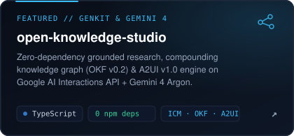
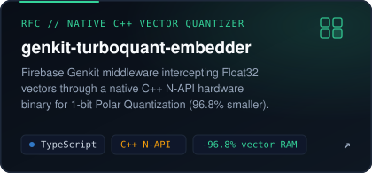
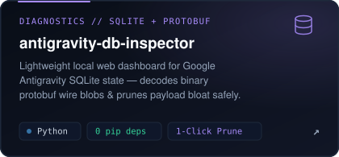
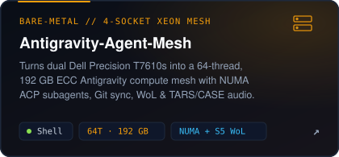
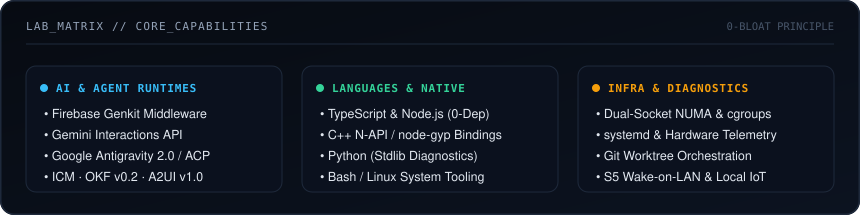

 

> *"I have a cue light I can use to show you when I'm joking, if you like."* — TARS
>
> Building **high-leverage AI developer tooling**, **zero-dependency Genkit & Gemini pipelines**, and **bare-metal compute infrastructure** — keeping abstractions transparent, binaries close to the silicon, and runtime bloat at zero.

---

### `01 //` Featured Genkit & AI Tooling

  
  &nbsp;
  

  
  &nbsp;
  

---

### `02 //` Ecosystem & Sidecar Utilities

| Repository | Stack | Purpose |
| :--- | :--- | :--- |
| [**`antigravity.google`**](https://github.com/CatoPaus/antigravity.google) | `Shell` · `Ubuntu / Debian` | Portable version checker & automated updater for the Google Antigravity 2.0 suite (`Hub`, `IDE`, `CLI`). |
| [**`genkit`**](https://github.com/CatoPaus/genkit) | `TypeScript` | Fork & experimentation sandbox for Google's open-source Genkit AI framework. |
| [**`node-banana-genkit`**](https://github.com/CatoPaus/node-banana-genkit) | `TypeScript` | Node-based visual workflow editor built around Genkit pipelines. |
| [**`unifi-google-nest-hub`**](https://github.com/CatoPaus/unifi-google-nest-hub) | `Batch` · `IoT` | Local casting bridge for streaming UniFi cameras onto Google Nest Hub displays. |

---

### `03 //` Lab Architecture & Stack

  

---

<code>SYS_LOG //</code> How I Design AI &amp; Systems Software

- **Zero-Runtime-Dependency Bias:** Whether it is `open-knowledge-studio` in TypeScript or `antigravity-db-inspector` in Python, core tooling should run cleanly from the standard library without fragile dependency trees.
- **File-Backed Epistemics:** Agent state belongs in inspectable artifacts on disk (`ICM`), not trapped inside opaque framework closures.
- **Close to the Hardware:** From 1-bit Polar Quantization in C++ N-API (`genkit-turboquant-embedder`) to NUMA-pinned `systemd` slices across dual Xeon T7610s (`Antigravity-Agent-Mesh`), software works best when it respects memory layout and CPU topology.

  <code>EOF //</code> Built in the lab · <a href="https://github.com/CatoPaus?tab=repositories">Browse all repositories ↗</a>

