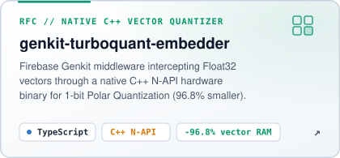
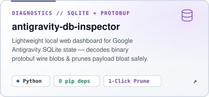
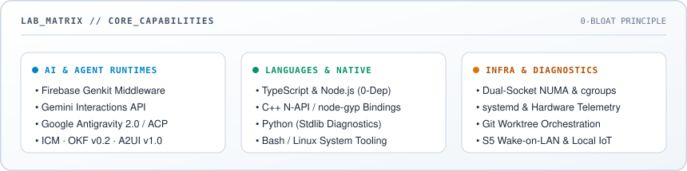

<picture>
  <source media="(prefers-color-scheme: dark)" srcset="./assets/hero-banner.svg" />
  <source media="(prefers-color-scheme: light)" srcset="./assets/hero-banner-light.svg" />
  
</picture>

 

<a href="https://github.com/CatoPaus">
  <picture>
    <source media="(prefers-color-scheme: dark)" srcset="https://img.shields.io/badge/GitHub-@CatoPaus-0D1117?style=for-the-badge&logo=github&logoColor=38BDF8&labelColor=090E17" />
    <source media="(prefers-color-scheme: light)" srcset="https://img.shields.io/badge/GitHub-@CatoPaus-F8FAFC?style=for-the-badge&logo=github&logoColor=0284C7&labelColor=E2E8F0&color=0F172A" />
    
  </picture>
</a>
<a href="https://x.com/cato_paus">
  <picture>
    <source media="(prefers-color-scheme: dark)" srcset="https://img.shields.io/badge/X-@cato__paus-0D1117?style=for-the-badge&logo=x&logoColor=F8FAFC&labelColor=090E17" />
    <source media="(prefers-color-scheme: light)" srcset="https://img.shields.io/badge/X-@cato__paus-F8FAFC?style=for-the-badge&logo=x&logoColor=0F172A&labelColor=E2E8F0&color=0F172A" />
    
  </picture>
</a>
<a href="https://github.com/CatoPaus/genkit-turboquant-embedder">
  <picture>
    <source media="(prefers-color-scheme: dark)" srcset="https://img.shields.io/badge/Stack-Genkit_%26_Gemini-0D1117?style=for-the-badge&logo=google&logoColor=34D399&labelColor=090E17" />
    <source media="(prefers-color-scheme: light)" srcset="https://img.shields.io/badge/Stack-Genkit_%26_Gemini-F8FAFC?style=for-the-badge&logo=google&logoColor=059669&labelColor=E2E8F0&color=0F172A" />
    
  </picture>
</a>
<a href="https://github.com/CatoPaus/Antigravity-Agent-Mesh">
  <picture>
    <source media="(prefers-color-scheme: dark)" srcset="https://img.shields.io/badge/Mesh-4--Socket_Xeon-0D1117?style=for-the-badge&logo=linux&logoColor=F59E0B&labelColor=090E17" />
    <source media="(prefers-color-scheme: light)" srcset="https://img.shields.io/badge/Mesh-4--Socket_Xeon-F8FAFC?style=for-the-badge&logo=linux&logoColor=D97706&labelColor=E2E8F0&color=0F172A" />
    
  </picture>
</a>

> *"I have a cue light I can use to show you when I'm joking, if you like."* — TARS
>
> **Cato Paus Skrede** ([`catopaus.github.io`](https://catopaus.github.io/) · [`@CatoPaus`](https://github.com/CatoPaus) · [X `@cato_paus`](https://x.com/cato_paus)) builds **high-leverage AI developer tooling**, **zero-dependency Firebase Genkit & Gemini pipelines** (`open-knowledge-studio`, `genkit-turboquant-embedder`), **Google Antigravity diagnostics** (`antigravity-db-inspector`), and **bare-metal NUMA compute infrastructure** (`Antigravity-Agent-Mesh`) — keeping abstractions transparent, binaries close to the silicon, and runtime bloat at zero.

---

### `01 //` Featured Genkit & AI Tooling

  <a href="https://github.com/CatoPaus/open-knowledge-studio">
    <picture>
      <source media="(prefers-color-scheme: dark)" srcset="./assets/card-oks.svg" />
      <source media="(prefers-color-scheme: light)" srcset="./assets/card-oks-light.svg" />
      
    </picture>
  </a>
  &nbsp;
  <a href="https://github.com/CatoPaus/genkit-turboquant-embedder">
    <picture>
      <source media="(prefers-color-scheme: dark)" srcset="./assets/card-turboquant.svg" />
      <source media="(prefers-color-scheme: light)" srcset="./assets/card-turboquant-light.svg" />
      
    </picture>
  </a>

  <a href="https://github.com/CatoPaus/antigravity-db-inspector">
    <picture>
      <source media="(prefers-color-scheme: dark)" srcset="./assets/card-db-inspector.svg" />
      <source media="(prefers-color-scheme: light)" srcset="./assets/card-db-inspector-light.svg" />
      
    </picture>
  </a>
  &nbsp;
  <a href="https://github.com/CatoPaus/Antigravity-Agent-Mesh">
    <picture>
      <source media="(prefers-color-scheme: dark)" srcset="./assets/card-agent-mesh.svg" />
      <source media="(prefers-color-scheme: light)" srcset="./assets/card-agent-mesh-light.svg" />
      
    </picture>
  </a>

---

### `02 //` Ecosystem & Sidecar Utilities

| Repository | Stack | Purpose |
| :--- | :--- | :--- |
| [**`antigravity.google`**](https://github.com/CatoPaus/antigravity.google) | `Shell` · `Ubuntu / Debian` | Portable version checker & automated updater for the Google Antigravity 2.0 suite (`Hub`, `IDE`, `CLI`). |
| [**`genkit`**](https://github.com/CatoPaus/genkit) | `TypeScript` | Fork & experimentation sandbox for Google's open-source Genkit AI framework. |
| [**`node-banana-genkit`**](https://github.com/CatoPaus/node-banana-genkit) | `TypeScript` | Node-based visual workflow editor built around Genkit pipelines. |
| [**`unifi-google-nest-hub`**](https://github.com/CatoPaus/unifi-google-nest-hub) | `Batch` · `IoT` | Local casting bridge for streaming UniFi cameras onto Google Nest Hub displays. |

---

### `03 //` Lab Architecture & Stack

  <picture>
    <source media="(prefers-color-scheme: dark)" srcset="./assets/stack-telemetry.svg" />
    <source media="(prefers-color-scheme: light)" srcset="./assets/stack-telemetry-light.svg" />
    
  </picture>

---

<code>SYS_LOG //</code> How I Design AI &amp; Systems Software

- **Zero-Runtime-Dependency Bias:** Whether it is `open-knowledge-studio` in TypeScript or `antigravity-db-inspector` in Python, core tooling should run cleanly from the standard library without fragile dependency trees.
- **File-Backed Epistemics:** Agent state belongs in inspectable artifacts on disk (`ICM`), not trapped inside opaque framework closures.
- **Close to the Hardware:** From 1-bit Polar Quantization in C++ N-API (`genkit-turboquant-embedder`) to NUMA-pinned `systemd` slices across dual Xeon T7610s (`Antigravity-Agent-Mesh`), software works best when it respects memory layout and CPU topology.

  <code>EOF //</code> Built in the lab · <a href="https://catopaus.github.io/">catopaus.github.io ↗</a> · <a href="https://github.com/CatoPaus?tab=repositories">Browse all repositories ↗</a>

