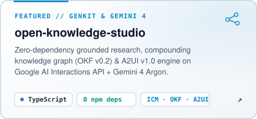
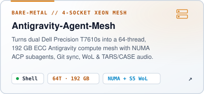

<picture>
  <source media="(prefers-color-scheme: dark)" srcset="./assets/hero-banner.svg" />
  <source media="(prefers-color-scheme: light)" srcset="./assets/hero-banner-light.svg" />
  
</picture>

 

<a href="https://catopaus.github.io/">
  <picture>
    <source media="(prefers-color-scheme: dark)" srcset="https://img.shields.io/badge/Lab_Site-catopaus.github.io-0D1117?style=for-the-badge&logo=googlechrome&logoColor=38BDF8&labelColor=090E17" />
    <source media="(prefers-color-scheme: light)" srcset="https://img.shields.io/badge/Lab_Site-catopaus.github.io-F8FAFC?style=for-the-badge&logo=googlechrome&logoColor=0284C7&labelColor=E2E8F0&color=0F172A" />
    
  </picture>
</a>
<a href="https://x.com/cato_paus">
  <picture>
    <source media="(prefers-color-scheme: dark)" srcset="https://img.shields.io/badge/X-@cato__paus-0D1117?style=for-the-badge&logo=x&logoColor=F8FAFC&labelColor=090E17" />
    <source media="(prefers-color-scheme: light)" srcset="https://img.shields.io/badge/X-@cato__paus-F8FAFC?style=for-the-badge&logo=x&logoColor=0F172A&labelColor=E2E8F0&color=0F172A" />
    
  </picture>
</a>
<a href="https://github.com/CatoPaus/genkit-turboquant-embedder">
  <picture>
    <source media="(prefers-color-scheme: dark)" srcset="https://img.shields.io/badge/Stack-Genkit_%26_Gemini-0D1117?style=for-the-badge&logo=google&logoColor=34D399&labelColor=090E17" />
    <source media="(prefers-color-scheme: light)" srcset="https://img.shields.io/badge/Stack-Genkit_%26_Gemini-F8FAFC?style=for-the-badge&logo=google&logoColor=059669&labelColor=E2E8F0&color=0F172A" />
    
  </picture>
</a>
<a href="https://github.com/CatoPaus/Antigravity-Agent-Mesh">
  <picture>
    <source media="(prefers-color-scheme: dark)" srcset="https://img.shields.io/badge/Mesh-4--Socket_Xeon-0D1117?style=for-the-badge&logo=linux&logoColor=F59E0B&labelColor=090E17" />
    <source media="(prefers-color-scheme: light)" srcset="https://img.shields.io/badge/Mesh-4--Socket_Xeon-F8FAFC?style=for-the-badge&logo=linux&logoColor=D97706&labelColor=E2E8F0&color=0F172A" />
    
  </picture>
</a>

> *"I have a cue light I can use to show you when I'm joking, if you like."* — TARS
>
> **Cato Paus Skrede** ([`catopaus.github.io`](https://catopaus.github.io/) · [`@CatoPaus`](https://github.com/CatoPaus) · [X `@cato_paus`](https://x.com/cato_paus)) is an **independent programmer and systems builder** exploring new AI technologies, native C++ performance, and bare-metal home servers—keeping abstractions transparent, binaries close to the silicon, and runtime bloat at zero.

---

### `01 //` Featured Projects (In Plain English & Under the Hood)

  <a href="https://github.com/CatoPaus/open-knowledge-studio">
    <picture>
      <source media="(prefers-color-scheme: dark)" srcset="./assets/card-oks.svg" />
      <source media="(prefers-color-scheme: light)" srcset="./assets/card-oks-light.svg" />
      
    </picture>
  </a>
  &nbsp;
  <a href="https://github.com/CatoPaus/genkit-turboquant-embedder">
    <picture>
      <source media="(prefers-color-scheme: dark)" srcset="./assets/card-turboquant.svg" />
      <source media="(prefers-color-scheme: light)" srcset="./assets/card-turboquant-light.svg" />
      
    </picture>
  </a>

  <a href="https://github.com/CatoPaus/Antigravity-Agent-Mesh">
    <picture>
      <source media="(prefers-color-scheme: dark)" srcset="./assets/card-agent-mesh.svg" />
      <source media="(prefers-color-scheme: light)" srcset="./assets/card-agent-mesh-light.svg" />
      
    </picture>
  </a>

- [**`open-knowledge-studio`**](https://github.com/CatoPaus/open-knowledge-studio) *(TypeScript · 0 runtime deps)* — Turns sprawling AI research into organized, fact-checked knowledge graphs and interactive offline workspaces stored cleanly on disk (`ICM`, `OKF v0.2`, `A2UI v1.0`, Google AI Interactions API + Gemini 4 Argon).
- [**`genkit-turboquant-embedder`**](https://github.com/CatoPaus/genkit-turboquant-embedder) *(TypeScript · C++ N-API · [Research Spec ↗](https://catopaus.github.io/turboquant/))* — Sends a **96-byte packed `Uint8Array` chunk** instead of ~15 KB of 64-bit float JSON (`number[]`), cutting **wire bandwidth by 99.37%**, **vector RAM by 96.88%** vs. Float32, and serialization power with ~114 ns native 64-bit POPCNT Hamming retrieval.
- [**`Antigravity-Agent-Mesh`**](https://github.com/CatoPaus/Antigravity-Agent-Mesh) *(Shell · Linux)* — Wires two used Dell Precision T7610 dual-Xeon workstations into a **4-socket, 64-thread, 192 GB ECC** home compute mesh that sleeps until needed, wakes via S5 Wake-on-LAN, and reports status through *Interstellar*-inspired **TARS & CASE** voices.

---

### `02 //` Ecosystem & Sidecar Utilities

| Repository | Stack | Purpose |
| :--- | :--- | :--- |
| [**`antigravity.google`**](https://github.com/CatoPaus/antigravity.google) | `Shell` · `Ubuntu / Debian` | Portable version checker & automated updater for the Google Antigravity 2.0 suite (`Hub`, `IDE`, `CLI`). |
| [**`unifi-google-nest-hub`**](https://github.com/CatoPaus/unifi-google-nest-hub) | `Batch` · `WebRTC / IoT` | Streams UniFi Protect security cameras onto Google Nest Hub displays with sub-second latency. |
| [**`node-banana-genkit`**](https://github.com/CatoPaus/node-banana-genkit) | `TypeScript` | Node-based visual workflow editor built around Genkit pipelines. |
| [**`genkit`**](https://github.com/CatoPaus/genkit) | `TypeScript` | Fork & experimentation sandbox for Google's open-source Genkit AI framework. |

---

### `03 //` Lab Architecture & Stack

  <picture>
    <source media="(prefers-color-scheme: dark)" srcset="./assets/stack-telemetry.svg" />
    <source media="(prefers-color-scheme: light)" srcset="./assets/stack-telemetry-light.svg" />
    
  </picture>

---

<code>SYS_LOG //</code> Why I Build Software This Way

- **Zero-Runtime-Dependency Bias:** Core tooling like `open-knowledge-studio` runs cleanly on the TypeScript/Node.js standard library without fragile dependency trees.
- **File-Backed Epistemics:** Agent state belongs in inspectable Markdown and JSON artifacts on disk (`ICM`), not trapped inside opaque framework closures.
- **Close to the Hardware:** From 1-bit Polar Quantization in C++ N-API (`genkit-turboquant-embedder`) to NUMA-pinned `systemd` slices across dual Xeon T7610 workstations (`Antigravity-Agent-Mesh`), software is most fun when it respects memory layout and real silicon.

  <code>EOF //</code> Built in the lab · <a href="https://catopaus.github.io/">catopaus.github.io ↗</a> · <a href="https://github.com/CatoPaus?tab=repositories">Browse all repositories ↗</a>

